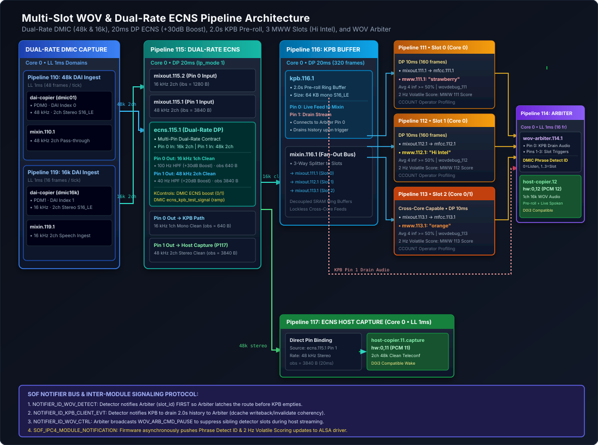
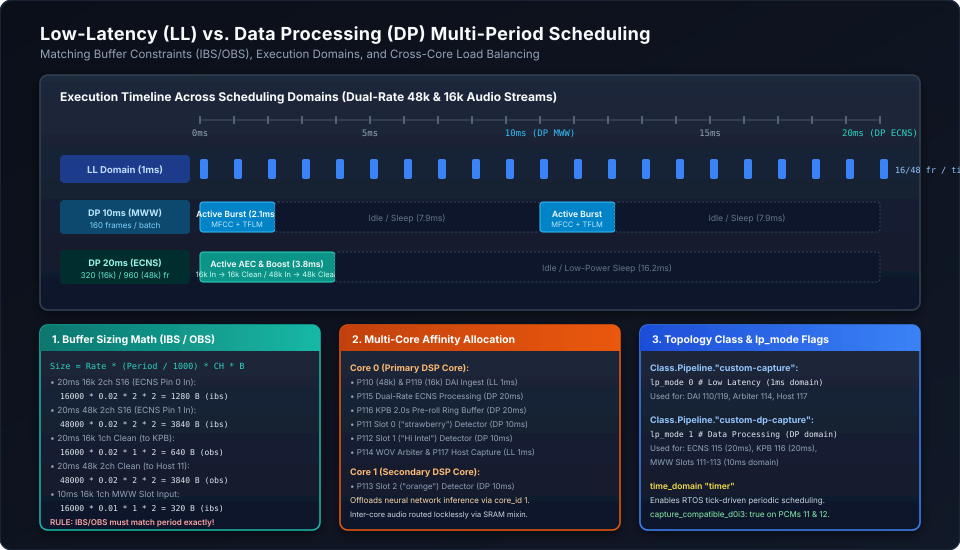

.. _wov_ecns_pipeline_guide:

How-To Guide: Customizing Multi-Slot WOV & ECNS Pipelines
#########################################################

.. contents::
   :local:
   :depth: 3

Sound Open Firmware (SOF) features a high-performance, multi-pipeline **Multi-Slot Wake-on-Voice (WOV) and Echo Cancellation & Noise Suppression (ECNS)** subsystem. This architecture enables simultaneous full-duplex communications, low-power continuous keyword spotting, and seamless pre-roll history audio streaming from a single Digital Microphone (DMIC) array or SoundWire headset interface.

The unified subsystem architecture is deployed across **Panther Lake (PTL)**, **Tiger Lake (TGL)**, and **Wildcat Lake (WCL)** (which shares the ACE 3.0 PTL architecture via topology symlinks).

This comprehensive developer guide details how the subsystem is structured, how inter-module communication is coordinated locklessly via the **SOF Notifier**, and provides a step-by-step walkthrough on how to **replace the ECNS and WOV modules with custom or third-party algorithms**, configure dual-rate DMIC inputs, adjust buffer constraints (IBS/OBS), utilize real-time scoring kcontrols, and reconfigure ALSA Topology 2.0.

---

Subsystem Architecture & Signal Flow
************************************

The baseline architecture coordinates ten interconnected pipelines spanning two distinct host audio capture streams originating from physical Digital Microphone (DMIC) hardware interfaces:

1. **ECNS Communication Stream (ALSA PCM 11 / ``hw:0,11``)**: Captures continuous, clean, noise-suppressed stereo 48 kHz speech (or 16 kHz when configured in single-producer mode). This stream feeds host-side teleconferencing applications (e.g. Teams, Zoom, WebRTC) or audio recorders requiring high-fidelity voice transmission free from acoustic feedback and room reverberation.
2. **WOV Keyword & Audio Stream (ALSA PCM 12 / ``hw:0,12``)**: Captures 2.0 seconds of cached historical audio from the Key Phrase Buffer (KPB) seamlessly concatenated with live speech from whichever keyword spotting slot triggered detection. This stream feeds host voice assistants (e.g. Alexa, Google Assistant, custom on-device wake-word engines).

Both capture endpoints support low-power D0i3 listening and wake (``capture_compatible_d0i3: true``).

Dual-Rate DMIC Hardware Interface (PDM0 & PDM1)
===============================================

Modern DMIC controllers support multiple independent PDM (Pulse Density Modulation) hardware links. The baseline architecture establishes two synchronous hardware DAI capture interfaces:

* **PDM Interface ``dmic01`` (DAI Index 0 on PDM0)**: Ingests 48 kHz, 2-channel stereo, 16-bit audio (Pipeline 110). This link supplies the high-resolution acoustic stream for teleconferencing, media capture, and host applications.
* **PDM Interface ``dmic16k`` (DAI Index 1 on PDM1)**: Ingests 16 kHz, 2-channel stereo, 16-bit audio (Pipeline 119). This link provides a dedicated lower-rate voice stream optimized for low-power voice trigger processing without requiring software sample rate conversion (SRC).

.. note::
   **Single-Producer Fallback**:
   The ECNS module includes built-in fallback support for single-producer configurations (such as hardware platforms or topologies with only a single 16 kHz DMIC DAI or when the 48 kHz stream is disabled). In this fallback mode, ECNS consumes from the 16 kHz input and synthesizes the required routing.

Three Functional Processing Phases
==================================

The audio graph processes audio through three distinct functional phases:

* **Phase 1: Low-Latency DAI Ingest (Pipelines 110 & 119)**: Ingests 48 kHz 2-channel audio (Pipeline 110, 48 frames per tick) and 16 kHz 2-channel audio (Pipeline 119, 16 frames per tick) at 1 ms intervals, maintaining minimum input latency before batching into Data Processing chunks.
* **Phase 2: Dual-Rate ECNS & History Buffering (Pipelines 115 & 116)**: Operates in a 20 ms Data Processing (DP) period (``lp_mode 1``). Pipeline 115 (Dual-Rate ECNS) ingests both 16 kHz voice (Pin 0 In, 320 frames = 1280 bytes) and 48 kHz capture (Pin 1 In, 960 frames = 3840 bytes), producing 16 kHz mono clean speech (Pin 0 Out, 640 bytes) directly to Pipeline 116 (Key Phrase Buffer) and 48 kHz stereo clean speech (Pin 1 Out, 3840 bytes) directly to Pipeline 117 (ECNS Host Capture on PCM 11). Pipeline 116 maintains a continuous 2.0-second circular history buffer (64 KB mono) in DSP SRAM.
* **Phase 3: Multi-Slot Keyword Detection & Arbitration (Pipelines 111–114)**: Three parallel detector slots (Pipelines 111–113) execute in 10 ms DP periods (160 frames at 16 kHz) monitoring for "strawberry" (Slot 0), "Hi Intel" (Slot 1), and "orange" (Slot 2). When a slot triggers, Pipeline 114 (WOV Arbiter, LL 1ms) latches the active slot, updates the ``DMIC Phrase Detect ID`` control, drains the 2.0-second pre-roll history buffer, and streams audio to ALSA PCM 12.

   Figure: Multi-Slot WOV & Dual-Rate ECNS Pipeline Architecture across dual DMIC capture (48k & 16k), 20ms DP ECNS, 2.0s KPB pre-roll, 3 concurrent detector slots ("strawberry", "Hi Intel", "orange"), WOV Arbiter, and the SOF Notifier bus.

Pipeline Graph Breakdown
========================

.. list-table:: Multi-Slot WOV and ECNS Pipeline Specification
   :widths: 12 18 20 50
   :header-rows: 1

   * - Pipeline ID
     - Name
     - Scheduling Domain
     - Components & Signal Flow
   * - **Pipeline 110**
     - 48k DAI Capture
     - Core 0 • LL 1 ms (48 frames)
     - ``dai-copier.DMIC.dmic01.capture`` (2ch 48 kHz S16_LE) → ``mixin.110.1`` (48k 2ch pass-through).
   * - **Pipeline 119**
     - 16k DAI Capture
     - Core 0 • LL 1 ms (16 frames)
     - ``dai-copier.DMIC.dmic16k.capture`` (2ch 16 kHz S16_LE) → ``mixin.119.1`` (16k 2ch pass-through).
   * - **Pipeline 115**
     - Dual-Rate ECNS
     - Core 0 • DP 20 ms (``lp_mode 1``)
     - ``mixout.115.2`` (16k) & ``mixout.115.1`` (48k) → ``ecns.115.1``. Produces:
       - **Pin 0 Out**: 16 kHz 1ch mono clean (OBS 640 B) → direct to ``kpb.116.1``.
       - **Pin 1 Out**: 48 kHz 2ch stereo clean (OBS 3840 B) → direct to ``host-copier.11.capture``.
   * - **Pipeline 116**
     - KPB History Buffer
     - Core 0 • DP 20 ms (320 frames)
     - ``kpb.116.1`` (2.0s = 64 KB mono circular buffer):
       - **Pin 0**: Live feed → ``mixin.116.1`` (3-way fan-out to detector slots).
       - **Pin 1**: Host sink drain stream → ``wov-arbiter.114.1`` Pin 0.
   * - **Pipeline 111**
     - WOV Slot 0
     - Core 0 • DP 10 ms (160 frames)
     - ``mixout.111.1`` → ``mfcc.111.1`` → ``mww.111.1`` (keyword model: "strawberry").
   * - **Pipeline 112**
     - WOV Slot 1
     - Core 0 • DP 10 ms (160 frames)
     - ``mixout.112.1`` → ``mfcc.112.1`` → ``mww.112.1`` (keyword model: "Hi Intel").
   * - **Pipeline 113**
     - WOV Slot 2
     - **Core 0 or Core 1** • DP 10 ms
     - ``mixout.113.1`` → ``mfcc.113.1`` → ``mww.113.1`` (keyword model: "orange"). Demonstrates **cross-core task offload**.
   * - **Pipeline 114**
     - WOV Arbiter & Capture
     - Core 0 • LL 1 ms (16 frames)
     - ``wov-arbiter.114.1`` (Pin 0 audio + Pins 1–3 triggers) → ``host-copier.12.capture`` (ALSA PCM 12, ``hw:0,12``).
   * - **Pipeline 117**
     - ECNS Host Capture
     - Core 0 • LL 1 ms (48 frames)
     - ``host-copier.11.capture`` (ALSA PCM 11, ``hw:0,11``, 48 kHz stereo clean).

SoundWire Headset Alternative (Pipelines 140-148)
=================================================

In topologies configured with SoundWire headset audio (such as Realtek ALC721 or ALC722 on Tiger Lake or Panther Lake via ``sdw-jack-wov-multi.conf``), a parallel pipeline topology structure is instantiated:

* **Pipeline 140**: Sample Rate Converter (SRC) converting 48 kHz headset microphone capture down to 16 kHz.
* **Pipelines 141–143**: Multi-slot keyword detector slots for headset microphones.
* **Pipeline 144**: Headset WOV Arbiter exposing the ``Jack In Phrase Detect ID`` ALSA mixer control.
* **PCM Endpoints**:
  - **ALSA PCM 13 (``hw:0,13``)**: Headset ECNS Stereo Capture (48 kHz S16_LE).
  - **ALSA PCM 14 (``hw:0,14``)**: Headset Multi-WOV Keyword Capture (16 kHz S16_LE).

---

SOF Notifier Inter-Module Event Bus
***********************************

A central architectural pillar in this subsystem is the lockless, zero-IPC event dispatch provided by the **SOF Notifier**. Because all modules execute inside the same DSP address space, inter-module events are dispatched synchronously without serialization or kernel intervention.

.. list-table:: SOF Notifier Events in WOV/ECNS Subsystem
   :widths: 25 18 18 39
   :header-rows: 1

   * - Notifier Event ID
     - Producer
     - Consumer
     - Action & Payload
   * - ``NOTIFIER_ID_WOV_DETECT``
     - Triggered Detector (e.g. Slot 0)
     - ``wov-arbiter``
     - Passes ``struct wov_detect_notif { uint8_t slot_id; }``. Arbiter latches the winning slot, switches the active audio route, and unmuts audio.
   * - ``NOTIFIER_ID_KPB_CLIENT_EVT``
     - Triggered Detector
     - ``kpb``
     - Passes ``struct kpb_event_data`` with ``KPB_EVENT_BEGIN_DRAINING``. Commands KPB to rapidly pump 2.0s of cached history audio to the Arbiter.
   * - ``NOTIFIER_ID_WOV_CTRL``
     - ``wov-arbiter``
     - Sibling Detectors
     - Broadcasts ``WOV_ARB_CMD_PAUSE`` to pause sibling inference, or ``WOV_ARB_CMD_RESUME`` on stream reset.
   * - ``SOF_IPC4_MODULE_NOTIFICATION``
     - Firmware (Arbiter / MWW)
     - Linux ALSA Driver
     - Asynchronously pushes ``DMIC Phrase Detect ID`` enum changes and 2 Hz volatile scoring kcontrol updates to host.

Critical Architectural Rules for Event Dispatch
===============================================

1. Mandatory Notification Sequencing Order
------------------------------------------

.. important::
   **Activate Arbiter BEFORE Draining KPB**:
   The WOV Arbiter discards everything arriving on its KPB input pin while no slot is active. If the keyword detector signals KPB to drain before notifying the Arbiter, the entire 2.0-second history buffer is drained into the Arbiter and discarded before the Arbiter switches to the detecting slot. As a result, the captured stream would start with live audio following the keyword, losing the wake-word!

   Therefore, detector modules **must** send the detection notification to the Arbiter first and command KPB draining second:

   .. code-block:: c

      /* 1. Activate Arbiter FIRST so audio routing is latched */
      struct wov_detect_notif arb_payload = { .slot_id = cd->slot_id };
      notifier_event(dev, NOTIFIER_ID_WOV_DETECT,
                     NOTIFIER_TARGET_CORE_ALL_MASK,
                     &arb_payload, sizeof(arb_payload));

      /* 2. Command KPB to drain 2.0s history audio downstream */
      mww_notify_kpb(mod);

2. Cross-Core Cache Coherency
-----------------------------

When a detector module runs on a secondary core (such as Core 1) while KPB and Arbiter execute on Core 0:

* The keyword trigger passes a ``struct kpb_event_data`` whose ``client_data`` pointer references a ``struct kpb_client`` allocated in the detector's core memory.
* Standard ``notifier_event()`` dispatch only writes back the outer ``kpb_event_data`` structure, not nested pointer targets.
* **Firmware Rule**: The notifying module must explicitly call ``dcache_writeback_region()`` on its ``client_data`` structure prior to firing ``notifier_event()``. In turn, the KPB event handler calls ``dcache_invalidate_region()`` on the received ``client_data`` pointer before inspecting buffer parameters.

3. Blocking Remote Core Notifications
-------------------------------------

In multi-core DSP configurations, ``notifier_event()`` delivers cross-core notifications via Inter-Processor Communication (IDC) messages using ``IDC_BLOCKING`` mode. Because each target core has a single notification data slot, blocking until remote completion guarantees that rapid back-to-back events (such as ``NOTIFIER_ID_WOV_DETECT`` followed immediately by ``NOTIFIER_ID_KPB_CLIENT_EVT``) do not overwrite queued event payloads or resubmit in-flight IDC work items.

Notifier Registration & Lifecycle
=================================

Modules subscribe to events during ``prepare()`` or ``init()``:

.. code-block:: c

   #include <sof/lib/notifier.h>
   #include <sof/audio/wov_arbiter/wov_arbiter.h>
   #include <sof/audio/kpb.h>

   /* Subscribe to PAUSE / RESUME control commands from WOV Arbiter */
   notifier_register(dev, cd, NOTIFIER_ID_WOV_CTRL, my_wov_ctrl_callback, 0);

.. warning::
   **Mandatory Unregistration**:
   Any module that registers a notifier callback **must** explicitly call ``notifier_unregister(dev, cd, NOTIFIER_ID_WOV_CTRL)`` during its ``reset()`` and ``free()`` routines. Failing to unregister leaves dangling function pointers in the global dispatch table, triggering kernel or DSP exception panics when subsequent events occur after pipeline teardown.

---

Step-by-Step Guide: Replacing the ECNS Module
*********************************************

The ECNS module performs Acoustic Echo Cancellation (AEC), Noise Suppression (NS), and dual-stream signal routing. Developers can replace the reference ECNS module with custom neural noise suppressors (e.g. RNNoise, DeepFilterNet), open-source algorithms (WebRTC AEC3, SpeexDSP), or proprietary vendor DSP libraries.

Step 1: Understand the Dual-Rate Multi-Pin Contract
===================================================

The ECNS component operates as a multi-sink, multi-source Data Processing (DP) block under a 20 ms period (``lp_mode 1``):

* **Input Pin 0 (16 kHz 2-Channel Stereo Ingest)**:
  - Source: ``dai-copier.DMIC.dmic16k.capture`` (Pipeline 119).
  - Rate: 16,000 Hz · 2 channels (or 4 channels on specific hardware layouts) · ``S16_LE``.
  - Input Buffer Size: :math:`16000 \times 0.020 \times 2 \times 2 = \mathbf{1280\text{ bytes}}` (``ibs 1280``).
* **Input Pin 1 (48 kHz 2-Channel Stereo Ingest)**:
  - Source: ``dai-copier.DMIC.dmic01.capture`` (Pipeline 110).
  - Rate: 48,000 Hz · 2 channels (or 4 channels) · ``S16_LE``.
  - Input Buffer Size: :math:`48000 \times 0.020 \times 2 \times 2 = \mathbf{3840\text{ bytes}}` (``ibs 3840``).
* **Output Pin 0 (Clean Mono Voice to KPB / WOV)**:
  - Destination: ``kpb.116.1`` (Pipeline 116).
  - Rate: 16,000 Hz · 1 channel (mono clean speech) · ``S16_LE``.
  - Output Buffer Size: :math:`16000 \times 0.020 \times 1 \times 2 = \mathbf{640\text{ bytes}}` (``obs 640``).
* **Output Pin 1 (Clean Stereo Voice to Host PCM 11)**:
  - Destination: ``host-copier.11.capture`` (Pipeline 117).
  - Rate: 48,000 Hz · 2 channels (stereo clean speech) · ``S16_LE``.
  - Output Buffer Size: :math:`48000 \times 0.020 \times 2 \times 2 = \mathbf{3840\text{ bytes}}` (``obs 3840``).

Step 2: Implement Built-In High-Pass Filters & Boost Switching
==============================================================

To optimize detection accuracy on acoustic microphone streams, the ECNS reference implementation incorporates built-in Direct Form I (DF1) second-order biquad high-pass filters:

1. **Pin 0 Detection Output Filter (100 Hz HPF)**:
   - Configured via ``CONFIG_ECNS_KPB_HPF``.
   - Boosted mode applies **+30 dB fixed gain** to elevate quiet speech peaks (typically around -36 dBFS) well above ambient room background.
   - Normal mode applies the identical 100 Hz response with **0 dB gain**.
2. **Pin 1 Host Output Filter (40 Hz HPF)**:
   - Configured via ``CONFIG_ECNS_HOST_HPF``.
   - Boosted mode applies **+20 dB fixed gain**.
   - Normal mode applies the identical 40 Hz response with **0 dB gain**.

Capture Boost Switch Control (``DMIC ECNS boost``)
--------------------------------------------------

The firmware exposes an ALSA mixer boolean switch control (``DMIC ECNS boost`` for DMIC instances; ``Jack In ECNS boost`` for headset instances).

* **Live Dynamic Switching**: Changing this control does **not** reset the filter delay lines. The firmware simply swaps the active IIR coefficient pointer between the 0 dB and +30 dB / +20 dB coefficient sets during streaming inside ``copy()``, ensuring clickless, glitch-free transitions.
* **Default State**: Firmware initializes with boosted filters enabled. When the ALSA card is instantiated, the host driver sets the control to its default value (0 dB).

Synthetic Test Signal Generator (``CONFIG_ECNS_TEST_SIGNAL``)
-------------------------------------------------------------

For automated CI and hardware validation, the ECNS component includes an optional synthetic ramp generator enabled via ``CONFIG_ECNS_TEST_SIGNAL=y``. When the mixer switch control ``DMIC ecns_kpb_test_signal`` (control index 1) is enabled, the ECNS module replaces Pin 0 output data with a deterministic sawtooth test ramp. This allows end-to-end verification of KPB history draining and WOV audio capture without needing a physical loudspeaker or spoken voice.

Step 3: Component Implementation Skeleton
=========================================

Implement the multi-pin audio adapter in ``src/audio/ecns/custom_ecns.c``:

.. code-block:: c

   // SPDX-License-Identifier: BSD-3-Clause
   #include <sof/audio/module_adapter/module/generic.h>
   #include <sof/audio/component.h>
   #include <sof/audio/buffer.h>
   #include <rtos/init.h>

   SOF_DEFINE_REG_UUID(custom_ecns);
   LOG_MODULE_REGISTER(custom_ecns, CONFIG_SOF_LOG_LEVEL);

   #define ECNS_CTRL_INDEX_CAPTURE_BOOST 0
   #define ECNS_CTRL_INDEX_TEST_SIGNAL   1

   struct custom_ecns_comp_data {
       struct ipc4_base_module_cfg base_cfg;
       bool capture_boost;
       bool capture_boost_req;
       uint32_t test_signal_enabled;
       void *aec_state;
   };

   static int custom_ecns_init(struct processing_module *mod)
   {
       struct custom_ecns_comp_data *cd = mod_alloc(sizeof(*cd));
       if (!cd)
           return -ENOMEM;

       mod->priv_data = cd;
       cd->capture_boost = false;
       cd->capture_boost_req = false;
       cd->test_signal_enabled = 0;
       return 0;
   }

   static int custom_ecns_process(struct processing_module *mod,
                                  struct sof_source **sources, int num_of_sources,
                                  struct sof_sink **sinks, int num_of_sinks)
   {
       struct custom_ecns_comp_data *cd = module_get_private_data(mod);
       struct sof_source *src16k = sources[0];  /* Pin 0: 16 kHz 2ch */
       struct sof_source *src48k = sources[1];  /* Pin 1: 48 kHz 2ch */
       struct sof_sink *sink_kpb = sinks[0];    /* Pin 0: 16 kHz 1ch Clean */
       struct sof_sink *sink_host = sinks[1];   /* Pin 1: 48 kHz 2ch Clean */

       /* 1. Handle live capture boost kcontrol switch request */
       if (cd->capture_boost != cd->capture_boost_req)
           cd->capture_boost = cd->capture_boost_req;

       /* 2. Verify independent input data availability */
       if (source_get_data_available(src16k) < 1280)
           return 0; /* Wait for full 20ms period @ 16 kHz */

       if (src48k && source_get_data_available(src48k) < 3840)
           return 0; /* Wait for full 20ms period @ 48 kHz */

       /* 3. Check independent sink free space */
       if (sink_kpb && sink_get_free_size(sink_kpb) < 640)
           return 0;

       if (sink_host && sink_get_free_size(sink_host) < 3840)
           return 0;

       /* 4. Acquire buffer pointers and execute custom algorithm */
       const int16_t *in16k = source_get_read_ptr(src16k);
       int16_t *out_kpb = sink_get_write_ptr(sink_kpb);

       /* Extract Left channel or run AEC/NS */
       for (int i = 0; i < 320; i++)
           out_kpb[i] = in16k[i * 2];

       if (src48k && sink_host) {
           const int16_t *in48k = source_get_read_ptr(src48k);
           int16_t *out_host = sink_get_write_ptr(sink_host);
           memcpy_s(out_host, 3840, in48k, 3840);
           sink_seek_write_ptr(sink_host, 3840);
           source_seek_read_ptr(src48k, 3840);
       }

       /* 5. Commit consumed and produced frames */
       source_seek_read_ptr(src16k, 1280);
       sink_seek_write_ptr(sink_kpb, 640);

       return 0;
   }

---

Step-by-Step Guide: Replacing the WOV / Keyword Detector Module
***************************************************************

In multi-slot keyword spotting architectures, multiple detector modules run in parallel pipelines, each monitoring the clean mono speech stream for a specific trigger phrase (Slot 0 for "strawberry", Slot 1 for "Hi Intel", Slot 2 for "orange"). Developers can replace the reference ``mww`` (microWakeWord) component with custom neural acoustic models, TensorFlow Lite for Microcontrollers (TFLM) graphs, or proprietary vendor engines (e.g. Picovoice Porcupine, Sensory TrulyHandsfree).

Acoustic Inference Architecture
===============================

The detector component executes under a 10 ms Data Processing period (160 frames at 16 kHz):

1. **Feature Extraction (MFCC)**: Batches 160 samples (10 ms) into 40-band Mel-frequency cepstral coefficients (184 bytes per chunk).
2. **Streaming Neural Network (TFLM)**: microWakeWord executes streaming convolutions using stateful temporal ring buffers, outputting a sigmoid confidence probability :math:`P \in [0.0, 1.0]`.

Averaged Probability Trigger Mechanism
======================================

.. note::
   **Overcoming Single-Frame Fluctuations**:
   Neural network inference probabilities fluctuate significantly across consecutive audio hops during keyword utterance (e.g., 95% followed immediately by 22%). Requiring multiple consecutive inferences above 85% frequently causes missed wake-words.

   The subsystem implements a **4-inference moving window average**:
   
   .. math::

      \bar{P} = \frac{1}{4} \sum_{i=0}^{3} P[n - i]

   Detection triggers when :math:`\bar{P} \ge \text{MWW\_DETECT\_THRESHOLD}` (default **0.50** or 50%). Testing confirms that spoken keywords achieve 4-frame averages between 56% and 67%, while conversational speech remains reliably below 25%.

Test Trigger Switch with 5-Second Delay (``wovdebug``)
======================================================

Each detector slot exposes a volatile ALSA mixer switch control named ``wovdebug_<pipeline_id>`` (e.g. ``wovdebug_111``, ``wovdebug_112``, ``wovdebug_113``):

* **Automated CI Validation**: Setting this control to ``1`` via ``amixer`` arms a synthetic test trigger.
* **5-Second Arming Delay**: Rather than triggering instantly, the component starts a 5000 ms countdown timer (configurable via ``CONFIG_COMP_MWW_FAKE_WAKE_MS``). The timer counts down during active audio processing in ``process()``.
* **Expiration & Reset**: Upon timer expiration, the component activates the Arbiter, commands KPB history buffer draining, and automatically pushes an ALSA notification resetting the control back to ``0``.
* **D0i3 State Resilience**: If the system transitions into low-power D0i3 while the timer is armed, the deadline is automatically re-calculated from D0i3 entry, guaranteeing that the target sleeps for the expected duration before firing wake.

Per-Operator Inference Cycle Profiling
======================================

When ``CONFIG_COMP_MWW_PROFILE=y`` is enabled, the detector implements TensorFlow Lite Micro's ``MicroProfilerInterface``. The profiler reads Xtensa processor ``CCOUNT`` registers before and after every neural network operator in invoke order:

* Evaluates execution cycles spent in ``CONV_2D``, ``DEPTHWISE_CONV_2D``, ``FULLY_CONNECTED``, and activation kernels.
* Excludes the initial cold subgraph invocation after reset.
* Logs a per-operator average cycle summary to DSP trace logs upon stream closure.

Real-Time Volatile Scoring Controls (2 Hz)
==========================================

To provide real-time UI feedback (such as signal strength meters or wake-word confidence visualization), each slot exposes a discrete enum scoring control (e.g. ``MWW 111 Score``):

.. important::
   **Kernel Dynamic Widget Constraint**:
   In the Linux SOF driver (``sound/soc/sof/topology.c``), dynamic pipeline widgets are **prohibited** from including ``SNDRV_CTL_ELEM_ACCESS_VOLATILE`` in their topology manifests:

   .. code-block:: c

      if (pipe_widget->dynamic_pipeline_widget) {
          if (scontrol->access & SNDRV_CTL_ELEM_ACCESS_VOLATILE)
              return -EINVAL; /* Rejects topology loading! */
      }

   **Architecture Solution**: Omit ``volatile`` from the topology ``access []`` definition. Instead, the DSP firmware calculates peak confidence over 50 hops (500 ms = 2 Hz) and pushes asynchronous updates using ``SOF_IPC4_MODULE_NOTIFICATION`` with ``SOF_IPC4_ENUM_CONTROL_PARAM_ID``. The kernel notification handler updates its internal cached value directly and dispatches ``snd_ctl_notify()``.

Detector Implementation Skeleton
================================

Implement the detector module in ``src/audio/my_wov/my_wov.c``:

.. code-block:: c

   // SPDX-License-Identifier: BSD-3-Clause
   #include <sof/audio/module_adapter/module/generic.h>
   #include <sof/audio/wov_arbiter/wov_arbiter.h>
   #include <sof/audio/kpb.h>
   #include <sof/lib/notifier.h>
   #include <rtos/cache.h>

   #define MWW_DETECT_AVG_LEN 4
   #define MWW_DETECT_THRESHOLD 0.50f

   struct my_wov_comp_data {
       uint8_t slot_id;
       bool paused;
       float prob_hist[MWW_DETECT_AVG_LEN];
       uint32_t prob_hist_idx;
       struct kpb_event_data event_data;
       struct kpb_client client_data;
   };

   static void my_wov_trigger_detection(struct processing_module *mod)
   {
       struct comp_dev *dev = mod->dev;
       struct my_wov_comp_data *cd = module_get_private_data(mod);

       /* 1. Activate Arbiter FIRST */
       struct wov_detect_notif arb_notif = { .slot_id = cd->slot_id };
       notifier_event(dev, NOTIFIER_ID_WOV_DETECT,
                      NOTIFIER_TARGET_CORE_ALL_MASK,
                      &arb_notif, sizeof(arb_notif));

       /* 2. Command KPB to drain history buffer */
       cd->client_data.id = cd->slot_id;
       cd->client_data.drain_req = 2000; /* 2.0s pre-roll */
       cd->event_data.event_id = KPB_EVENT_BEGIN_DRAINING;
       cd->event_data.client_data = &cd->client_data;

       /* Write back cache for cross-core coherency */
       dcache_writeback_region((__sparse_force void __sparse_cache *)&cd->client_data,
                               sizeof(cd->client_data));

       notifier_event(dev, NOTIFIER_ID_KPB_CLIENT_EVT,
                      NOTIFIER_TARGET_CORE_ALL_MASK,
                      &cd->event_data, sizeof(cd->event_data));
   }

   static void on_wov_ctrl(void *arg, enum notify_id id, void *data)
   {
       struct comp_dev *dev = arg;
       struct my_wov_comp_data *cd = module_get_private_data(dev->mod);
       const struct wov_ctrl_notif *n = data;

       if (n->cmd == WOV_ARB_CMD_PAUSE && n->slot_id != cd->slot_id) {
           cd->paused = true;
       } else if (n->cmd == WOV_ARB_CMD_RESUME) {
           cd->paused = false;
           memset(cd->prob_hist, 0, sizeof(cd->prob_hist));
       }
   }

---

WOV Arbiter & Multi-Slot Coordination
*************************************

The ``wov-arbiter`` component synchronizes multi-slot pipelines, arbitrates between competing detection triggers, and routes the winning audio stream into ``host-copier.12.capture`` (ALSA PCM 12).

Arbiter State Machine & Control Enum
====================================

The arbiter exposes the volatile read-only ALSA mixer control **``DMIC Phrase Detect ID``** (or **``Jack In Phrase Detect ID``** for headset instances):

.. list-table:: Phrase Detect ID Control States
   :widths: 15 20 65
   :header-rows: 1

   * - Enum Value
     - Item String
     - Operational State
   * - ``0``
     - ``Listening``
     - All detector slots actively scanning microphone audio.
   * - ``1``
     - ``Slot 1``
     - Slot 0 ("strawberry") triggered. Sibling slots paused. Pre-roll + live audio streaming to host.
   * - ``2``
     - ``Slot 2``
     - Slot 1 ("Hi Intel") triggered. Sibling slots paused. Pre-roll + live audio streaming to host.
   * - ``3``
     - ``Slot 3``
     - Slot 2 ("orange") triggered. Sibling slots paused. Pre-roll + live audio streaming to host.

Mutual Exclusion (Single Active WoV PCM)
========================================

Because DMIC and headset WoV graphs share ``NOTIFIER_ID_WOV_DETECT`` and DSP memory accommodates one active neural network working set, the arbiter enforces strict mutual exclusion. Opening a second WoV PCM stream while one is already active is immediately rejected with an error, preventing memory collisions.

---

Scheduling, Periods & Buffer Sizing in Topology 2.0
***************************************************

   Figure: Execution timeline across Low-Latency (LL 1ms) and Data Processing (DP 10ms / 20ms) domains, mathematical IBS/OBS buffer sizing, and multi-core task balancing.

Buffer Sizing Formula (IBS & OBS)
=================================

In ALSA Topology 2.0, input buffer size (``ibs``) and output buffer size (``obs``) govern memory allocation and scheduling wakeups:

.. math::

   \text{Buffer Size (bytes)} = \text{Sample Rate (Hz)} \times \left(\frac{\text{Period (ms)}}{1000}\right) \times \text{Channels} \times \text{Bytes Per Sample}

.. list-table:: Dual-Rate Buffer Sizing Lookup Matrix (S16_LE = 2 Bytes Per Sample)
   :widths: 22 15 15 18 30
   :header-rows: 1

   * - Component Block
     - Period
     - Rate
     - Channels
     - Calculated Size (IBS / OBS)
   * - **48k DAI Capture** (P110)
     - 1 ms (LL)
     - 48,000 Hz
     - 2 channels
     - :math:`48000 \times 0.001 \times 2 \times 2 = \mathbf{192\text{ bytes}}`
   * - **16k DAI Capture** (P119)
     - 1 ms (LL)
     - 16,000 Hz
     - 2 channels
     - :math:`16000 \times 0.001 \times 2 \times 2 = \mathbf{64\text{ bytes}}`
   * - **ECNS Pin 0 In** (16k)
     - 20 ms (DP)
     - 16,000 Hz
     - 2 channels
     - :math:`16000 \times 0.020 \times 2 \times 2 = \mathbf{1280\text{ bytes}}` (``ibs``)
   * - **ECNS Pin 1 In** (48k)
     - 20 ms (DP)
     - 48,000 Hz
     - 2 channels
     - :math:`48000 \times 0.020 \times 2 \times 2 = \mathbf{3840\text{ bytes}}` (``ibs``)
   * - **ECNS Pin 0 Out** (Clean Mono)
     - 20 ms (DP)
     - 16,000 Hz
     - 1 channel
     - :math:`16000 \times 0.020 \times 1 \times 2 = \mathbf{640\text{ bytes}}` (``obs``)
   * - **ECNS Pin 1 Out** (Clean Stereo)
     - 20 ms (DP)
     - 48,000 Hz
     - 2 channels
     - :math:`48000 \times 0.020 \times 2 \times 2 = \mathbf{3840\text{ bytes}}` (``obs``)
   * - **KPB Pre-Roll Buffer** (P116)
     - 2000 ms
     - 16,000 Hz
     - 1 channel
     - :math:`16000 \times 2.000 \times 1 \times 2 = \mathbf{64000\text{ bytes}}` (~64 KB)
   * - **MWW Detector Slot** (P111–113)
     - 10 ms (DP)
     - 16,000 Hz
     - 1 channel
     - :math:`16000 \times 0.010 \times 1 \times 2 = \mathbf{320\text{ bytes}}` (``ibs/obs``)

Cross-Core Task Affinity (``core_id``)
======================================

On multi-core DSP architectures (such as Intel cAVS 2.5 on Tiger Lake and ACE on Panther Lake / Wildcat Lake), running three concurrent keyword detectors on Core 0 can cause core saturation. SOF supports cross-core task affinity in Topology 2.0:

* **Core 0 (Primary Core)**: Pipelines 110, 119, 115 (ECNS), 116 (KPB), 111 (Slot 0), 112 (Slot 1), 114 (Arbiter), 117 (Host Capture).
* **Core 1 (Secondary Core)**: Pipeline 113 (Slot 2 Detector) assigned via ``core_id 1``. Inter-core audio frames are transferred locklessly across DSP cache boundaries via SRAM buffers.

---

Building, Deploying & Verifying the Pipeline
********************************************

Target Topology Manifests
=========================

.. list-table:: Target Topology Manifest Matrix
   :widths: 25 35 40
   :header-rows: 1

   * - Target Platform
     - Manifest File
     - Binary Topology Output
   * - **Panther Lake (PTL / ACE 3.0)**
     - ``dmic-wov-multi-ptl-4ch-manifest.conf``
     - ``sof-ptl-dmic-wov-multi-4ch.tplg``
   * - **Tiger Lake (TGL / CAVS 2.5)**
     - ``dmic-wov-multi-4ch-manifest.conf``
     - ``sof-tgl-dmic-wov-multi-4ch.tplg``
   * - **Wildcat Lake (WCL / ACE 3.0)**
     - Symlink to Panther Lake topology
     - ``sof-wcl-dmic-wov-multi-4ch.tplg``
   * - **SoundWire Headset WoV**
     - ``sdw-jack-wov-multi.conf``
     - Embedded in SoundWire codec topologies

Compiling Topology with NHLT Preprocessor Plugin
================================================

.. code-block:: bash

   cd $SOF_WORKSPACE/sof
   TPLG2=$(pwd)/tools/topology/topology2
   ALSA_TMP=/tmp/alsa-tplg-wov

   mkdir -p $ALSA_TMP
   cp /usr/share/alsa/alsa.conf $ALSA_TMP/
   ln -sf $TPLG2/include  $ALSA_TMP/include
   ln -sf $TPLG2/platform $ALSA_TMP/platform

   # Compile Multi-WOV Topology with embedded NHLT
   ALSA_CONFIG_DIR=$ALSA_TMP ALSA_TOPOLOGY_PLUGIN_DIR=/usr/lib/alsa-topology alsatplg \
       -I $TPLG2 -p \
       -c tools/topology/topology2/dmic-wov-multi-4ch-manifest.conf \
       -o /tmp/sof-tgl-dmic-wov-multi-4ch.tplg

BIOS NHLT Table Override (``sof_use_tplg_nhlt=1``)
==================================================

Add to ``/etc/modprobe.d/sof.conf`` on the target DUT:

.. code-block:: ini

   options snd_sof tplg_path=intel/sof-ipc4-tplg tplg_filename=sof-tgl-dmic-wov-multi-4ch.tplg
   options snd_sof_intel_hda_common sof_use_tplg_nhlt=1

Reload the audio driver stack:

.. code-block:: bash

   ssh root@<target_ip> '
     modprobe -r snd_sof_pci_intel_tgl snd_sof_intel_hda_common snd_sof
     modprobe snd_sof_intel_hda_common sof_use_tplg_nhlt=1
     modprobe snd_sof_pci_intel_tgl
   '

Verifying Streams & Controls on Hardware
========================================

Step 1: Inspect ALSA Capture Endpoints
--------------------------------------

.. code-block:: bash

   ssh root@<target_ip> 'arecord -l'

Expected output listing PCM 11 and PCM 12:

.. code-block:: text

   card 0: sofhdadsp [sof-hda-dsp], device 11: DMIC ECNS Capture (*) []
     Subdevices: 1/1
     Subdevice #0: subdevice #0
   card 0: sofhdadsp [sof-hda-dsp], device 12: DMIC Multi-WOV (*) []
     Subdevices: 1/1
     Subdevice #0: subdevice #0

Step 2: Capture Continuous ECNS Clean Speech (PCM 11)
-----------------------------------------------------

Record a 5-second sample from PCM 11 at 48 kHz stereo:

.. code-block:: bash

   ssh root@<target_ip> 'arecord -D hw:0,11 -c 2 -r 48000 -f S16_LE -d 5 /tmp/ecns_clean.wav'

Step 3: Monitor Active Keyword Slot State via ALSA Mixer
--------------------------------------------------------

Query the active phrase detection state:

.. code-block:: bash

   ssh root@<target_ip> "amixer -c0 cget name='DMIC Phrase Detect ID'"

Output indicates:
* ``0``: Listening across all detector slots.
* ``1``: Slot 1 detected ("strawberry").
* ``2``: Slot 2 detected ("Hi Intel").
* ``3``: Slot 3 detected ("orange").

Step 4: Capture Triggered Keyword Audio with 2.0s Pre-Roll (PCM 12)
-------------------------------------------------------------------

When speaking a trigger phrase (e.g. "Hi Intel"), record the drained audio stream from PCM 12:

.. code-block:: bash

   ssh root@<target_ip> 'arecord -D hw:0,12 -c 1 -r 16000 -f S16_LE -d 4 /tmp/wov_trigger.wav'

Automated Testing & Diagnostic Tools
====================================

The SOF tree provides dedicated testing and capture utilities under ``tools/wov_capture/``:

1. ``wov_capture_app``
----------------------

A standalone C capture tool communicating directly via Linux ALSA PCM kernel UAPI ioctls with zero external library dependencies:

* **Keyword-Gated Readiness**: Explicitly waits for PCM readiness when capturing from gated WOV devices.
* **CLI Options**:
  - ``-D CARD``: Sound card index (default 0).
  - ``-d DEV``: PCM device number (e.g. ``-d 12`` for WOV; ``-d 11`` for ECNS).
  - ``-r RATE``: Sample rate in Hz (e.g. ``-r 16000`` or ``-r 48000``).
  - ``-c CHANS``: Number of audio channels (e.g. ``-c 1`` for mono; ``-c 2`` for stereo).
  - ``-f FORMAT``: Sample format (``S16_LE`` or ``S32_LE``).
  - ``-t DURATION``: Capture duration in seconds.
  - ``-n CYCLES``: Number of automated capture cycles.
  - ``-o DIR``: Output directory for standard RIFF WAV files.

2. Automated Multi-Slot Test Suite (``wov_multi_slot_test.py``)
---------------------------------------------------------------

Automates trigger injection and state verification across all three detector slots:

.. code-block:: bash

   python3 tools/wov_capture/wov_multi_slot_test.py --card 0 --device 12

3. Automated 10x S0 / D0i3 Test Runner (``run_wov_10x.py``)
-----------------------------------------------------------

Validates power transitions and driver stability across 10 consecutive S0 active captures and 10 consecutive low-power D0i3 wake cycles.

---

Summary: Developer "Watch Out" Checklist
****************************************

.. list-table:: WOV & ECNS Customization Checklist
   :widths: 20 40 40
   :header-rows: 1

   * - Domain
     - Common Failure Mode
     - Correct Engineering Rule
   * - **Notification Order**
     - Signaling KPB drain before notifying the Arbiter.
     - **Always activate Arbiter first** (``NOTIFIER_ID_WOV_DETECT``), then command KPB to drain (``NOTIFIER_ID_KPB_CLIENT_EVT``).
   * - **Multi-Pin Output**
     - Attempting to output both mono and stereo streams from a single output pin.
     - Declare 2 output pins on ECNS: Pin 0 = 16k 1ch mono (to KPB), Pin 1 = 48k 2ch stereo (to Host PCM 11).
   * - **Buffer Sizing (IBS/OBS)**
     - Declaring mismatched ``ibs`` or ``obs`` in topology versus component frame chunk size.
     - Calculate exact byte sizes: Pin 0 In = 1280 B, Pin 1 In = 3840 B, Pin 0 Out = 640 B, Pin 1 Out = 3840 B.
   * - **Cross-Core Coherency**
     - Passing nested event pointers to Core 0 without dcache writeback.
     - Call ``dcache_writeback_region()`` on ``client_data`` before dispatching ``notifier_event()`` to remote cores.
   * - **Dynamic Widget Controls**
     - Specifying ``volatile`` in topology ``access []`` for dynamic widgets.
     - Omit ``volatile`` from topology to avoid kernel ``-EINVAL``. Dispatch asynchronous ``SOF_IPC4_MODULE_NOTIFICATION`` from firmware.
   * - **Model Naming**
     - Referencing obsolete "banana" model for Slot 1.
     - Use updated **"Hi Intel"** model (``mww_model_data_hi_intel``) on Slot 1 (Pipeline 112).
   * - **Mixer Control Naming**
     - Looking for legacy ``wov_active_slot`` control name.
     - Query **``DMIC Phrase Detect ID``** for DMIC topologies and **``Jack In Phrase Detect ID``** for headset topologies.
   * - **Mutual Exclusion**
     - Attempting to open DMIC and headset WOV streams simultaneously.
     - The arbiter permits only one active WoV PCM stream at a time.
