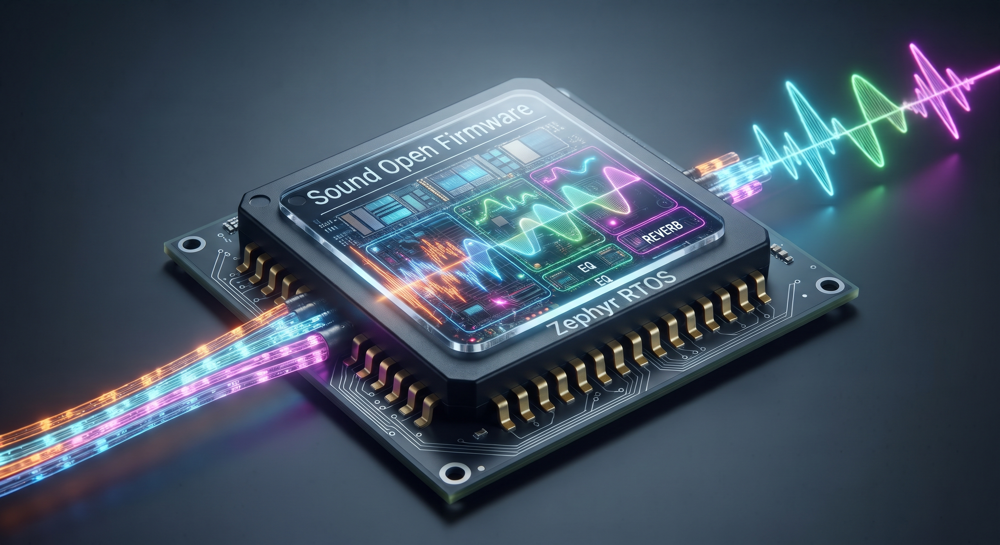

.. _SOF_home:

Sound Open Firmware Documentation
#################################

Welcome to the **Sound Open Firmware (SOF)** technical documentation portal.

Sound Open Firmware is a permissively licensed, open-source audio Digital Signal Processing (DSP) firmware infrastructure, SDK, and real-time execution framework governed under the **Linux Foundation** and directed by the **SOF Technical Steering Committee (TSC)**.

SOF provides transparent, deterministic, low-latency audio processing infrastructure for modern computing architectures ranging from embedded microcontrollers and IoT devices to multi-core client PCs and servers.

Architecture & Key Capabilities
*******************************

Sound Open Firmware delivers a unified, cross-platform audio software stack across two foundational deployment paradigms:

* **Host-Based Client Architecture**: Where the DSP operates as an accelerator coupled to a host application processor running **Linux**, **ChromeOS**, **Android**, or **Windows**. The mainline Linux kernel driver subsystem (``sound/soc/sof/``) manages firmware lifecycle, dynamic ALSA topology parsing, and aggressive power gating (D0ix runtime idle, D3 cold suspend), while real-time audio streams exchange through mailbox IPC protocols (IPC4 and IPC3) and host DMA memory windows.
* **Hostless & Standalone Architecture**: Where SOF executes autonomously on microcontrollers and embedded DSPs (such as the **Espressif ESP32-P4** or **PJRC Teensy 4.1 / i.MX RT1062**) atop the **Zephyr RTOS**. Standalone topologies process audio directly between hardware peripherals (I2S/TDM, SoundWire, PDM microphones, and S/PDIF) without requiring a host OS.

Documentation Pillars & Navigation
**********************************

Explore the documentation portal by selecting one of the core technical pillars below:

.. raw:: html

   

     

       <h4 style="margin-top: 0; color: var(--pst-color-primary, #0a7d91); font-size: 1.15rem; font-weight: 600;">
         <a href="introduction/index.html" style="text-decoration: none; color: inherit;">Introduction to SOF &rarr;</a>
       </h4>
       

         Learn about the SOF project mission, benefits of audio DSP offloading (power, deterministic latency, vertical stack centralization), licensing, and governance.
       

       <a href="introduction/index.html" style="font-size: 0.875rem; font-weight: 600; color: var(--pst-color-primary, #0a7d91);">Read Introduction &raquo;</a>
     

     

       <h4 style="margin-top: 0; color: var(--pst-color-primary, #0a7d91); font-size: 1.15rem; font-weight: 600;">
         <a href="getting_started/index.html" style="text-decoration: none; color: inherit;">Getting Started &rarr;</a>
       </h4>
       

         Set up your build host, configure the LLVM/Clang Xtensa cross-compiler toolchain, compile firmware images for target platforms, and run simulation in QEMU.
       

       <a href="getting_started/index.html" style="font-size: 0.875rem; font-weight: 600; color: var(--pst-color-primary, #0a7d91);">Explore Quickstart &raquo;</a>
     

     

       <h4 style="margin-top: 0; color: var(--pst-color-primary, #0a7d91); font-size: 1.15rem; font-weight: 600;">
         <a href="architectures/index.html" style="text-decoration: none; color: inherit;">Architecture & System Design &rarr;</a>
       </h4>
       

         Deep dive into firmware architecture: audio pipeline execution graphs (DAGs), lockless ring buffers, Zephyr RTOS abstraction, IPC3/IPC4 protocols, and power management.
       

       <a href="architectures/index.html" style="font-size: 0.875rem; font-weight: 600; color: var(--pst-color-primary, #0a7d91);">View Architecture &raquo;</a>
     

     

       <h4 style="margin-top: 0; color: var(--pst-color-primary, #0a7d91); font-size: 1.15rem; font-weight: 600;">
         <a href="platforms/index.html" style="text-decoration: none; color: inherit;">Supported Platforms Matrix &rarr;</a>
       </h4>
       

         Hardware compatibility specifications across Intel CAVS & ACE (PTL, ARL, MTL, TGL), AMD, NXP i.MX, MediaTek, Espressif ESP32-P4, and PJRC Teensy 4.1.
       

       <a href="platforms/index.html" style="font-size: 0.875rem; font-weight: 600; color: var(--pst-color-primary, #0a7d91);">Browse Platforms &raquo;</a>
     

     

       <h4 style="margin-top: 0; color: var(--pst-color-primary, #0a7d91); font-size: 1.15rem; font-weight: 600;">
         <a href="algos/index.html" style="text-decoration: none; color: inherit;">Audio Algorithms & Components &rarr;</a>
       </h4>
       

         Comprehensive catalog of built-in audio signal processing modules: Volume, Mixer, Parametric EQ (FIR/IIR), DRC, SRC, ASRC, Crossover, DCBlock, and Wake-on-Voice.
       

       <a href="algos/index.html" style="font-size: 0.875rem; font-weight: 600; color: var(--pst-color-primary, #0a7d91);">Inspect Algorithms &raquo;</a>
     

     

       <h4 style="margin-top: 0; color: var(--pst-color-primary, #0a7d91); font-size: 1.15rem; font-weight: 600;">
         <a href="developer_guides/index.html" style="text-decoration: none; color: inherit;">Developer Guides & Runbooks &rarr;</a>
       </h4>
       

         Step-by-step developer runbooks: ALSA Topology 2 creation, UCM2 configuration and debugging, LLEXT dynamic module integration, CMake workflows, and real-time DSP probes.
       

       <a href="developer_guides/index.html" style="font-size: 0.875rem; font-weight: 600; color: var(--pst-color-primary, #0a7d91);">Read Guides &raquo;</a>
     

     

       <h4 style="margin-top: 0; color: var(--pst-color-primary, #0a7d91); font-size: 1.15rem; font-weight: 600;">
         <a href="api/index.html" style="text-decoration: none; color: inherit;">C API & Firmware Reference &rarr;</a>
       </h4>
       

         Interactive Doxygen API documentation and Sphinx Breathe subsystem reference for IPC4, LLEXT modules, pipeline scheduling, audio components, RTOS abstraction, and DSP math.
       

       <a href="api/index.html" style="font-size: 0.875rem; font-weight: 600; color: var(--pst-color-primary, #0a7d91);">Explore C API &raquo;</a>
     

     

       <h4 style="margin-top: 0; color: var(--pst-color-primary, #0a7d91); font-size: 1.15rem; font-weight: 600;">
         <a href="contribute/index.html" style="text-decoration: none; color: inherit;">Community & Contributing &rarr;</a>
       </h4>
       

         Join the SOF open-source community: contributor guidelines, Git patch submission rules, TSC meeting minutes, releases, and frequently asked questions.
       

       <a href="contribute/index.html" style="font-size: 0.875rem; font-weight: 600; color: var(--pst-color-primary, #0a7d91);">Contribute &raquo;</a>
     

   

.. toctree::
   :hidden:

   SOF Project Website <https://sofproject.org>
   introduction/index.rst
   getting_started/index.rst
   architectures/index.rst
   platforms/index.rst
   algos/index.rst
   developer_guides/index.rst
   release.rst
   contribute/index.rst
   tsc/index.rst
   api/index.rst
   presentations/index.rst
   faq/index.rst
